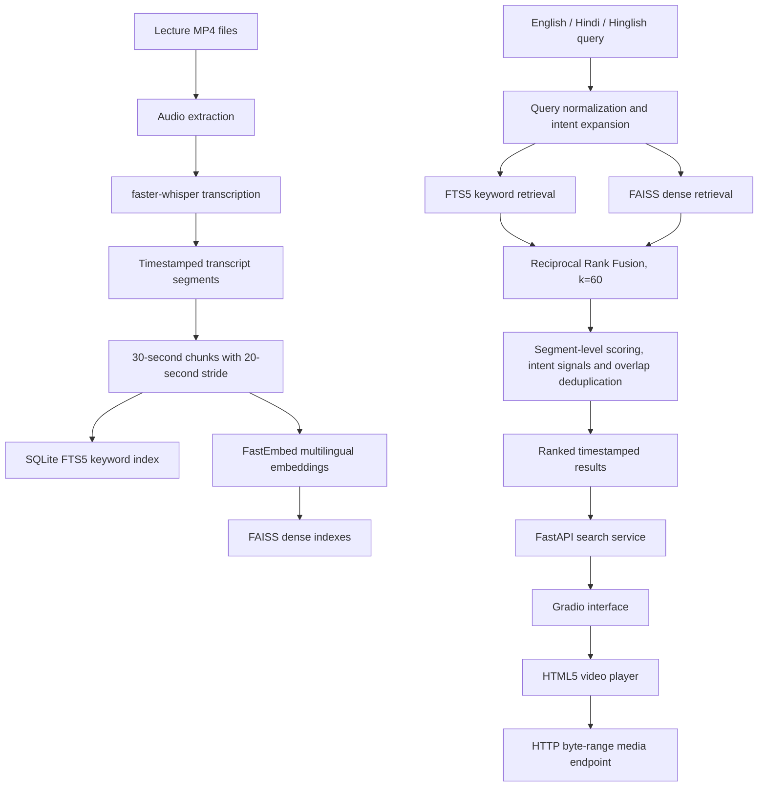

# System Architecture

## 1. Purpose

Hinglish Lecture Search is a local research prototype for searching within Operating Systems lecture recordings using natural-language questions written in English, Hindi or Hinglish. A result identifies a transcript segment, the source lecture and a timestamp that can be opened in the video player.

The project currently indexes five lectures:

| Lecture ID | Lecture topic |
|---|---|
| `os_l23_fcfs` | First Come First Serve scheduling |
| `os_l24_sjf` | Shortest Job First scheduling |
| `os_l39` | Process Synchronization |
| `os_l41_deadlock` | Deadlocks |
| `os_l58` | Paging and Memory Management |

## 2. High-level pipeline



## 3. Ingestion and transcript representations

The transcription pipeline uses `faster-whisper` and retains segment start/end timestamps. Two transcript configurations are evaluated:

- `base_auto`: the automatic-language base-model transcript.
- `small_hi`: the small-model Hindi-oriented transcript configuration used in the project's experiments.

The segment transcripts are converted into overlapping chunks of 30 seconds with a 20-second stride. The chunk metadata retains the lecture ID and time interval so retrieval results can be mapped back to the source recording.

## 4. Retrieval layer

The implementation combines complementary retrieval paths rather than relying on one matcher.

### Keyword retrieval

SQLite FTS5 provides lexical retrieval through `scripts/search_keyword.py`. This is useful when a query contains terms that are also present in the transcript, but can be brittle when Hindi and Romanized Hinglish words are represented differently by automatic speech recognition.

### Dense retrieval

The multilingual embedding model `sentence-transformers/paraphrase-multilingual-MiniLM-L12-v2` produces 384-dimensional embeddings. FAISS retrieves semantically similar transcript chunks. Dense search can bridge vocabulary differences, but may retrieve topically related passages that do not contain the precise answer or timestamp.

### Hybrid retrieval and ranking

The hybrid path combines keyword and dense rankings using Reciprocal Rank Fusion with `k=60`. It then selects unique timestamped transcript segments, applies query-aware intent signals and avoids returning redundant overlapping segments. Query expansion and intent logic cover lecture-specific terms and common English/Hindi/Romanized-Hindi variants. The intent logic is deliberately targeted: an intent boost is applied when the result text/context supports the requested concept, rather than merely because nearby transcript content mentions a related term.

The application-facing service delegates retrieval decisions to `scripts/search_hybrid.py`; the service adds resource caching, request validation and a stable result shape. The service caches dense resources and the embedding model, and serializes inference through a lock to avoid concurrent access to one model runtime.

## 5. Application layer

The application combines a FastAPI service with a Gradio browser interface.

### API surface

| Method | Path | Purpose |
|---|---|---|
| `GET` | `/api/health` | Reports application/index/transcript asset health. |
| `GET` | `/api/lectures` | Lists available lecture metadata without exposing local filesystem paths. |
| `POST` | `/api/search` | Searches timestamped segments. |
| `GET` | `/media/{lecture_id}` | Streams the selected lecture video. |
| `GET` | `/docs` | Interactive FastAPI documentation. |

The search request accepts a query (1–500 characters), a transcript configuration (`base_auto` or `small_hi`) and a bounded result limit. The service returns ranked results with lecture ID/title, segment start/end, formatted timestamp, transcript text, score fields, video availability and a timestamped media URL.

### Browser interface and timestamp playback

The Gradio interface provides a query box, transcript-configuration selector, result limit, ranked result table and an HTML5 video player. Selecting a result updates the player. The player URL uses a media fragment (`#t=<seconds>`) to request playback from the segment start time.

The media route serves MP4 files through Starlette's `FileResponse`. HTTP byte-range responses allow the browser to request only the parts of a video needed for metadata loading and seeking. A successful `206 Partial Content` response confirms byte-range delivery, but the final UI check must still verify the visible player position against the result timestamp.

## 6. Repository map

| Path | Responsibility |
|---|---|
| `scripts/transcribe.py` | Speech transcription |
| `scripts/extract_audio.py` | Audio extraction from lecture videos |
| `scripts/build_search_chunks.py` | Timestamped overlapping chunks |
| `scripts/build_keyword_index.py` | SQLite FTS5 index creation |
| `scripts/build_dense_index.py` | Dense embedding and FAISS index creation |
| `scripts/search_keyword.py` | Keyword retrieval |
| `scripts/search_dense.py` | Dense retrieval |
| `scripts/search_hybrid.py` | Hybrid retrieval, fusion and query-aware ranking |
| `scripts/run_benchmark.py` | Benchmark execution |
| `scripts/score_benchmark.py` | Timestamp-aware benchmark scoring |
| `src/lecture_search/search_service.py` | Application adapter and caching |
| `src/lecture_search/api.py` | FastAPI routes |
| `src/lecture_search/ui.py` | Gradio UI and player rendering |
| `app.py` | Application entry point |
| `tests/` | Retrieval intent, application and integration regressions |
| `data/evaluation/` | Query set, run logs and score exports |

## 7. Local execution

```bash
cd ~/Documents/lecture-search
source ~/venvs/lecture-search/bin/activate
python app.py
```

Open `http://127.0.0.1:7860`. API documentation is available at `http://127.0.0.1:7860/docs`.

The application is intended for local use. Keep the server bound to `127.0.0.1` for private lecture recordings unless external access is explicitly intended and appropriately protected.

## 8. Current boundaries

- The indexed corpus contains five Operating Systems lectures, not a broad multi-course collection.
- The current query set contains 30 development queries and is not a held-out test set.
- The delivered UI is text-query based. Voice query input, slide OCR and a learned reranker are not part of the current completed MVP.
- Timestamp playback must be confirmed in the browser; a successful HTTP byte-range response is not sufficient proof of correct visible seeking.
